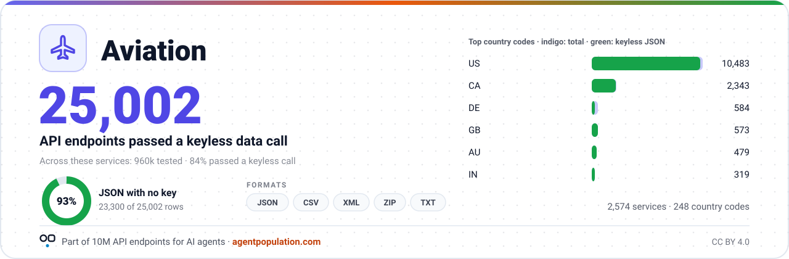
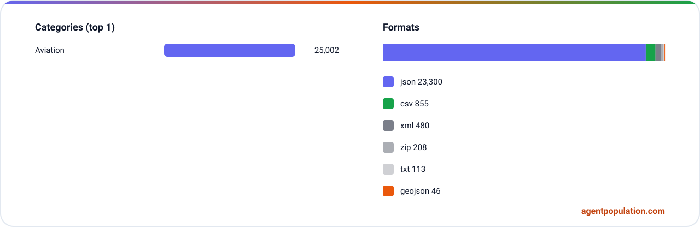

<p align="center"></p>

# ✈️ Aviation API endpoints

**25,002 aviation API endpoints that answered a keyless GET with a data body. For agent and app builders.**

<p align="center"><a href="#files"></a> <a href="#columns-and-tags"></a> <a href="#whats-inside"></a> <a href="#whats-inside"></a> <a href="LICENSE"></a></p>

<p align="center"><a href="#whats-in-it-for-you">What's in it</a> · <a href="#for-ai-agents">For AI agents</a> · <a href="#quick-start">Quick start</a> · <a href="#test-it-yourself">Test it yourself</a> · <a href="#files">Files</a> · <a href="#licence-and-credit">Licence</a> · <a href="#part-of-10m-api-endpoints-for-ai-agents">More packs</a></p>

This repository holds a 1,000-row sample and the services list; the full list of 25,002 endpoints is one download from the [latest release](https://github.com/agentpopulation/25k-aviation-apis-for-agents/releases/latest).

**Endpoints for building an airport-weather or flight tool.** METAR reports and TAF forecasts by airport code (most of the rows), airport lists by country, runway, airspace, obstacle, drone-zone and noise-contour map layers, air-traffic statistics and a few aircraft-position queries, as URLs that answered with no key on their test date.

Selection rule: rows where `category is "Aviation"`, less the rows that a leave-out rule drops (each counted under Known limits).

21,791 of these 25,002 rows match the focus rule (below); the others are in the pack by the selection rule only, and Known limits says what they are. 6,820 rows (27.3%) are map layers on ArcGIS Online, where anyone can publish.

## In plain words

**What is an API endpoint?** An API endpoint is one web address that a program can ask for data, for example the latest reading at one weather station. A single service, such as a national weather agency, can have thousands of endpoints: one per station, city or dataset. This pack counts endpoints, not separate services.

**What does "passed a data call" mean?** On the date shown in each row, AgentPopulation sent one plain request to that address, with no password or key, and got a non-empty data body back (JSON, CSV, XML or a file): not an error page and not an empty result. Some bodies describe a dataset rather than hold its values; see Known limits. It shows the address answered with data on that day. It is not a promise that it answers today, and licences and usage limits were not reviewed.

## What's in it for you

Four ways to use this pack. Each bucket gives a count, a filter you can apply to the CSV, one example that passed, and a list of recommended starting points with the rule that picked them. Buckets overlap; a row can fit more than one.

Examples, recommended lists and the preview are drawn from rows that match this pack's focus rule, so a row that the selection rule put in this pack but that is about something else is not shown as a starting point. Counts cover the whole bucket.

<details>
<summary>The focus rule</summary>

Focus rule: `title matches /airport|aiport|aéroport|aeroport|aeropuerto|flughafen|luchthaven|lufthavn|flyplass|летищ|airfield|aerodrome|aérodrome|airstrip|heliport|helipad|helicopt|hélicopt|runway|airspace|aviation|aircraft|\bflights?\b|air traffic|air passenger|air transport|air freight|airline|air carrier|metar|\btaf\b|\buas\b|drone|adsb|ads-b|opensky|luftfahrt|luftverkehr|flugh|low flying|obstacle limitation|\bafb\b|air base|\barpt\b/i AND NOT title or subcategory matches /ortho|aerial|luftbild|seam ?lines|cutting lines|flight ?lines|flight paths of the|vlieglijnen|image flight|bildflug|photo exposure|drone flight paths|drone locations|beetle|scolyt|migration and flight/i AND NOT title matches /benzol|benzene|ozone|carbon monoxide|nitrogen|sulph|sulfur|particulate|pm10|pm2|contribution rates|airport line/i AND NOT url matches /request=getcapabilities/i`

</details>

### 🤖 Agent tools: METAR, TAF and aircraft-position lookups an agent can call

**10,551** endpoints from 5 services · Wrap the METAR and TAF URL patterns as a get_airport_weather tool: pass an ICAO code, return wind, visibility, cloud and the forecast periods with the report time; add a timeout.

8,691 of these are METAR or TAF queries for one airport each (`ids=` in the URL); put another ICAO code there for another airport.

Start with: `tags has agent-ready AND ((subcategory is "METAR airport weather" OR subcategory is "TAF aerodrome forecast" OR (host is prodapi.met.ie AND url matches //observations//i)) OR host in (api.adsb.lol, opendata.adsb.fi, opensky-network.org))`

Example: [METAR: Honiara/Henderson Arpt (AGGH)](https://aviationweather.gov/api/data/metar?ids=AGGH&format=json) · US Aviation Weather Center · passed 2026-11-14

<details>
<summary>Recommended starting points: 5 services, picked by the stated criteria inside</summary>

**Recommended starting points.** Selected by stated criteria, not a ranking of quality: Services in this pack with the most endpoints that match this bucket and are tagged `agent-ready` (no key sent in the test call, JSON body, passed a data call). Ties go to the service with more country codes, then by name. Only services with at least one bucket row that matches the focus rule are listed, and the sample comes from those rows; the counts cover the whole bucket. The sample URL is the first row by URL sort after preferring, in this order: rows that match the bucket's sample preference when it has one, rows that return values rather than describe a dataset or a service (not ERDDAP /info/ pages, OGC GetCapabilities requests, bare OWS addresses, PxWeb tables, UN SDG series lists, Statistics Canada download pointers, WorldPop listings, GTFS validation reports, untitled rows or service root addresses), and agent-ready rows. Sample preference in this bucket: `subcategory is "METAR airport weather"`. Services named "ArcGIS organization" hold map layers from many owners and are added only when fewer than 5 other services match.

| Service (host) | Endpoints in bucket | In pack | Country codes in bucket | Formats in bucket | Sample URL that passed |
|---|---:|---:|---|---|---|
| US Aviation Weather Center (aviationweather.gov) | 8,691 | 9,612 | 230 codes | json | [METAR: Honiara/Henderson Arpt (AGGH)](https://aviationweather.gov/api/data/metar?ids=AGGH&format=json) (2026-11-14) |
| Adsb (opendata.adsb.fi) | 999 | 999 | 201 codes | json | [adsb.fi: Live aircraft within 40nm of K…](https://opendata.adsb.fi/api/v2/lat/-0.086/lon/34.729/dist/40) (2026-11-15) |
| Adsb (api.adsb.lol) | 836 | 836 | 41 codes | json | [adsb.lol: Airport record Honiara Intern…](https://api.adsb.lol/api/0/airport/AGGH) (2026-11-15) |
| OpenSky Network (opensky-network.org) | 16 | 16 | 15 codes | json | [OpenSky Network: Live aircraft state ve…](https://opensky-network.org/api/states/all?lamin=-47.3&lomin=166.4&lamax=-34.4&lomax=178.6) (2026-11-15) |
| Met (prodapi.met.ie) | 9 | 13 | IE | json | [Yesterday's weather Casement Aerodrome](https://prodapi.met.ie/observations/casement/yesterday) (2026-11-14) |

</details>

### 📱 App features: Airport, runway, airspace and drone-zone maps

**6,417** endpoints from 1,974 services · Show airports, runways, controlled airspace, drone no-fly zones and noise contours near a place on a map card.

6,142 of these are map-layer queries that asked for a few records (`resultRecordCount`); raise it or page through for the whole layer.

Start with: `NOT host is aviationweather.gov AND (tags has maps OR format is geojson) AND (subcategory matches /airport|airspace|aerodrome|aérodrome|flughafen/i OR title matches /runway|heliport|helipad|airspace|\buas\b|drone|noise|obstacle limitation/i)`

Example: [Airport Runway and Taxiway 1999](https://maps2.dcgis.dc.gov/dcgis/rest/services/DCGIS_DATA/Planimetrics_1999/MapServer/20/query?where=1%3D1&outFields=*&returnGeometry=false&resultRecordCount=5&f=json) · maps2.dcgis.dc.gov · passed 2026-11-14

<details>
<summary>Recommended starting points: 8 services, picked by the stated criteria inside</summary>

**Recommended starting points.** Selected by stated criteria, not a ranking of quality: Services in this pack with the most endpoints that match this bucket and passed a data call. Ties go to the service with more country codes, then by name. Only services with at least one bucket row that matches the focus rule are listed, and the sample comes from those rows; the counts cover the whole bucket. The sample URL is the first row by URL sort after preferring, in this order: rows that match the bucket's sample preference when it has one, rows that return values rather than describe a dataset or a service (not ERDDAP /info/ pages, OGC GetCapabilities requests, bare OWS addresses, PxWeb tables, UN SDG series lists, Statistics Canada download pointers, WorldPop listings, GTFS validation reports, untitled rows or service root addresses), and agent-ready rows. Sample preference in this bucket: `NOT url matches ///(services[0-9]*(-[a-z0-9]+)?|utility)\.arcgis\.com//i AND title matches /runway|airspace|heliport|\buas\b|drone|obstacle|noise/i`. Services named "ArcGIS organization" hold map layers from many owners and are added only when fewer than 5 other services match.

| Service (host) | Endpoints in bucket | In pack | Country codes in bucket | Formats in bucket | Sample URL that passed |
|---|---:|---:|---|---|---|
| BrisMAP Public (ArcGIS Online) (services2.arcgis.com) | 292 | 313 | AU, US | json | [City Plan 2014 - Airport environs overl…](https://services2.arcgis.com/dEKgZETqwmDAh1rP/arcgis/rest/services/CP2014_Airport_environs_overlay_BirdBatStrikeZone_PublicSafety_Bird_and_bat_strike_zone/FeatureServer/0/query?where=1%3D1&outFields=*&returnGeometry=false&resultRecordCount=5&f=json) (2026-11-14) |
| University of Florida (ArcGIS Online) (services.arcgis.com) | 107 | 133 | GB, US | json | [1wi\_airports](https://services.arcgis.com/LBbVDC0hKPAnLRpO/arcgis/rest/services/1wi_airports/FeatureServer/0/query?where=1%3D1&outFields=*&returnGeometry=false&resultRecordCount=5&f=json) (2026-11-14) |
| Transparenzportal Hamburg (archiv.transparenz.hamburg.de) | 95 | 95 | DE | xml | [Lärmschutzbereich Flughafen Hamburg - D…](https://archiv.transparenz.hamburg.de/hmbtgarchive/HMDK/hh_wfs_fluglaermschutzzonen_123391_snap_1.XML) (2026-11-15) |
| Western University (ArcGIS Online) (services.arcgis.com) | 89 | 89 | CA, US | json | [Airports](https://services.arcgis.com/rGKxabTU9mcXMw7k/arcgis/rest/services/Airports/FeatureServer/0/query?where=1%3D1&outFields=*&returnGeometry=false&resultRecordCount=5&f=json) (2026-11-14) |
| University of Wisconsin-Madison (ArcGIS Online) (services.arcgis.com) | 81 | 81 | CN, US | json | [576\_My\_Airports](https://services.arcgis.com/HRPe58bUyBqyyiCt/arcgis/rest/services/576_My_Airports/FeatureServer/0/query?where=1%3D1&outFields=*&returnGeometry=false&resultRecordCount=5&f=json) (2026-11-14) |
| Ball State University ArcGIS Online (ArcGIS Online) (services1.arcgis.com) | 72 | 72 | CN, US | json | [AK\_Airport\_ServiceArea\_WFL1](https://services1.arcgis.com/ROSiDsWkQXhsUAs0/arcgis/rest/services/AK_Airport_ServiceArea_WFL1/FeatureServer/0/query?where=1%3D1&outFields=*&returnGeometry=false&resultRecordCount=5&f=json) (2026-11-14) |
| Esri Aviation (ArcGIS Online) (services5.arcgis.com) | 67 | 79 | US | json | [AIRPORT\_FAR\_PART\_77\_\_Projected\_webmerc](https://services5.arcgis.com/62o2qANhRqripAuB/arcgis/rest/services/AIRPORT_FAR_PART_77__Projected_webmerc/FeatureServer/0/query?where=1%3D1&outFields=*&returnGeometry=false&resultRecordCount=5&f=json) (2026-11-14) |
| GIS WebTech (ArcGIS Online) (services6.arcgis.com) | 63 | 68 | AR, US | json | [AIRPORT](https://services6.arcgis.com/BAJNi3EgCdtQ1BCG/arcgis/rest/services/AIRPORT/FeatureServer/0/query?where=1%3D1&outFields=*&returnGeometry=false&resultRecordCount=5&f=json) (2026-11-14) |

</details>

### 🧠 Grounding and data pipelines: Airport lists, air-traffic statistics and airport weather series for scheduled loads

**1,725** endpoints from 172 services · Load airport lists, passenger and freight counts, flight movements and airport weather series on a schedule into your own store, so answers about an airport cite a dated source.

Start with: `NOT host is aviationweather.gov AND (tags has statistics OR format in (csv, xml, zip, txt))`

Example: [Airports in Andorra - List of airports in Andorra…](https://ourairports.com/countries/AD/airports.csv) · Ourairports · passed 2026-11-15

<details>
<summary>Recommended starting points: 8 services, picked by the stated criteria inside</summary>

**Recommended starting points.** Selected by stated criteria, not a ranking of quality: Services in this pack with the most endpoints that match this bucket and passed a data call. Ties go to the service with more country codes, then by name. Only services with at least one bucket row that matches the focus rule are listed, and the sample comes from those rows; the counts cover the whole bucket. The sample URL is the first row by URL sort after preferring, in this order: rows that match the bucket's sample preference when it has one, rows that return values rather than describe a dataset or a service (not ERDDAP /info/ pages, OGC GetCapabilities requests, bare OWS addresses, PxWeb tables, UN SDG series lists, Statistics Canada download pointers, WorldPop listings, GTFS validation reports, untitled rows or service root addresses), and agent-ready rows. Sample preference in this bucket: `title matches /airport|passenger|flight|air transport|air traffic/i AND NOT url contains "compressed=true"`. Services named "ArcGIS organization" hold map layers from many owners and are added only when fewer than 5 other services match.

| Service (host) | Endpoints in bucket | In pack | Country codes in bucket | Formats in bucket | Sample URL that passed |
|---|---:|---:|---|---|---|
| Ourairports (ourairports.com) | 463 | 463 | 161 codes | csv | [Airports in Andorra - List of airports …](https://ourairports.com/countries/AD/airports.csv) (2026-11-15) |
| S3 (AWS) (production-raw-data-api.s3.amazonaws.com) | 185 | 431 | 185 codes | zip | [HDX: Airports of Aruba](https://production-raw-data-api.s3.amazonaws.com/ISO3/ABW/airports/hotosm_abw_airports_osm_geojson.zip) (2026-11-14) |
| Usgs (data.usgs.gov) | 144 | 144 | US | xml | [Conservation Planning for the Colorado …](https://data.usgs.gov/datacatalog/metadata/USGS.583f0f6de4b04fc80e3a79ab.xml) (2026-11-15) |
| Eurostat dissemination API (ec.europa.eu) | 101 | 101 | EU | csv, txt | [Persons employed in main airports by sex](https://ec.europa.eu/eurostat/api/dissemination/sdmx/2.1/data/avia_ec_emp_arp?format=SDMX-CSV&compressed=true) (2026-11-14) |
| Datos Abiertos de Panamá (www.datosabiertos.gob.pa) | 100 | 137 | PA | csv | [Aeropuerto Internacional de Tocumen - D…](https://www.datosabiertos.gob.pa/dataset/020346b3-9f09-443b-96ee-3b3ad45524b2/resource/8da814c7-14f0-413e-b9d1-2070b7e079da/download/destinosmensualesaitsa2025.csv) (2026-11-15) |
| Transparenzportal Hamburg (archiv.transparenz.hamburg.de) | 95 | 95 | DE | xml | [Lärmschutzbereich Flughafen Hamburg - D…](https://archiv.transparenz.hamburg.de/hmbtgarchive/HMDK/hh_wfs_fluglaermschutzzonen_123391_snap_1.XML) (2026-11-15) |
| Destatis GENESIS (Germany) (genesis.destatis.de) | 72 | 72 | DE | txt, xml | [Take-offs, landings (flight stage): Ger…](https://genesis.destatis.de/genesisWS/downloads/00/tables/46421-0001_00.csv) (2026-11-14) |
| dokumente.nuernberg.de | 50 | 50 | DE | csv | [Nuremberg: Airport, air temperature](https://dokumente.nuernberg.de/opendata/Daten_SUN/2023_Lufttemperatur_FlughafenNuernberg.csv) (2026-11-14) |

</details>

### 🧪 Evals and testing: Airport weather, positions, layers and files to test a flight tool

**25,002** endpoints · 2,574 services · 248 country codes · 6 formats · Run your flight tool against a fixed set of URLs across formats; check that ICAO codes, report times, wind and visibility, positions and altitudes parse, and keep last_tested as the baseline for your own re-tests.

Start with: the whole pack

Example: [NOAA Aviation Weather Center: Airport info: Honia…](https://aviationweather.gov/api/data/airport?ids=AGGH&format=json) · US Aviation Weather Center · passed 2026-11-15

<details>
<summary>Recommended starting points: 8 services, picked by the stated criteria inside</summary>

**Recommended starting points.** Selected by stated criteria, not a ranking of quality: Services in this pack that returned the most different formats, then the most endpoints that passed a data call, then by name: a mix of response shapes to test parsers and tool calls. Only services with at least one bucket row that matches the focus rule are listed, and the sample comes from those rows; the counts cover the whole bucket. The sample URL is the first row by URL sort after preferring, in this order: rows that match the bucket's sample preference when it has one, rows that return values rather than describe a dataset or a service (not ERDDAP /info/ pages, OGC GetCapabilities requests, bare OWS addresses, PxWeb tables, UN SDG series lists, Statistics Canada download pointers, WorldPop listings, GTFS validation reports, untitled rows or service root addresses), and agent-ready rows. Services named "ArcGIS organization" hold map layers from many owners and are added only when fewer than 5 other services match.

| Service (host) | Endpoints in bucket | In pack | Country codes in bucket | Formats in bucket | Sample URL that passed |
|---|---:|---:|---|---|---|
| data.gov.au (datahub.moretonbay.qld.gov.au) | 25 | 25 | AU | geojson, xml, json, csv, zip | [Overlay Maps:OC10 Aerodrome Building He…](https://datahub.moretonbay.qld.gov.au/api/download/v1/items/c74f51448db844c2acbe3dc7fb9ef994/csv?layers=40) (2026-11-15) |
| Napsgfoundation (prep-response-portal.napsgfoundation.org) | 25 | 25 | global or unknown | csv, geojson, xml, json | [Unknown (Airport) - GeoJSON](https://prep-response-portal.napsgfoundation.org/api/download/v1/items/5d93352406744d658d9c1f43f12b560c/geojson?layers=4) (2026-11-15) |
| California Open Data Portal (gis.data.ca.gov) | 14 | 14 | US | xml, csv, geojson, json | [Airport Boundaries - GeoJSON](https://gis.data.ca.gov/api/download/v1/items/a65054bafb5345fb9884cce83c0dfe88/geojson?layers=0) (2026-11-15) |
| Open Development Mekong Datahub (data.opendevelopmentmekong.net) | 11 | 11 | KH, LA | json, geojson, xml, zip | [The number of flights in 2020 in Vietna…](https://data.opendevelopmentmekong.net/api/3/action/datastore_search?resource_id=11361914-6747-4760-aa40-02608b86845e&limit=1) (2026-11-15) |
| ArcGIS Online: Baronies (data-osi.opendata.arcgis.com) | 4 | 4 | IE | csv, geojson, json, zip | [Airports - National 250K Map Of Ireland](https://data-osi.opendata.arcgis.com/api/download/v1/items/d9caefb25af842f4a583c65ecd70cf1a/featureCollection?layers=0) (2026-11-14) |
| Datalk (www.datalk.cz) | 4 | 4 | CZ | csv, geojson, json, zip | [Airports and aviation activities](https://www.datalk.cz/api/download/v1/items/95fa7a11cca0403b875738a3facea211/featureCollection?layers=0) (2026-11-14) |
| Datazapad (www.datazapad.cz) | 4 | 4 | CZ | csv, geojson, json, zip | [Airports in the Karlovy Vary Region](https://www.datazapad.cz/api/download/v1/items/fc44327a17e04959b7c5209d9ce32820/featureCollection?layers=3) (2026-11-14) |
| data.ny.gov | 22 | 22 | US | json, xml, csv | [Coach Bus Passengers per Month at Port …](https://data.ny.gov/api/views/39r6-cbzf/rows.json?accessType=DOWNLOAD) (2026-11-15) |

</details>

The same lists are in [recommended.json](recommended.json), ready for an agent to load.

## Questions an agent can answer with this pack

- What is the latest METAR at a given airport? Try [METAR: Honiara/Henderson Arpt (AGGH)](https://aviationweather.gov/api/data/metar?ids=AGGH&format=json) (US Aviation Weather Center, passed 2026-11-14).
- What does the TAF forecast say for an airport over the next hours? Try [TAF forecast: Honiara/Henderson Arpt (AGGH)](https://aviationweather.gov/api/data/taf?ids=AGGH&format=json) (US Aviation Weather Center, passed 2026-11-14).
- Which aircraft are within a set radius of a point near Heathrow? Try [adsb.lol: Live aircraft within 40nm of Nauru Inte…](https://api.adsb.lol/v2/point/-0.548/166.92/40) (Adsb, passed 2026-11-15).
- Which airports does a country have, with codes and coordinates? Try [Airports in Andorra - List of airports in Andorra…](https://ourairports.com/countries/AD/airports.csv) (Ourairports, passed 2026-11-15).

## What "passed a data call" means

> [!NOTE]
> On the date in `last_tested` (IST), one GET to the URL, sent with no key, returned HTTP 2xx and a non-empty data body. HTML pages and empty results did not pass. The `format` column records what came back. This is a test result for that date, not a promise that the URL answers today. Licences, terms, rate limits, accuracy and freshness were not reviewed. Endpoints are URLs, not separate APIs; many share one service. This pack was tested 10–15 Nov 2026; snapshot 15 Nov 2026.

## For AI agents

Start from keyless JSON endpoints (`agent-ready`). The code below loads `recommended.json` and calls the first recommended service in the Agent tools bucket, with a timeout (`node examples/agent-start.mjs --recommended`). With no argument, `node examples/agent-start.mjs` calls the most recently tested agent-ready row of the sample; pass a `.csv` or `.csv.gz` path to use that file instead. See [examples/agent-start.mjs](examples/agent-start.mjs).

```js
// Node 18+. Loads recommended.json (the local copy, or the raw file on GitHub) and calls one keyless JSON endpoint.
import fs from 'node:fs';

const RAW = 'https://raw.githubusercontent.com/agentpopulation/25k-aviation-apis-for-agents/main/recommended.json';
const rec = fs.existsSync('recommended.json')
  ? JSON.parse(fs.readFileSync('recommended.json', 'utf8'))
  : await (await fetch(RAW)).json();

const pick = rec.buckets.find((b) => b.id === 'agent').services[0];
try {
  const res = await fetch(pick.sample_url, {
    headers: { 'User-Agent': 'agent-example/1.0' },
    signal: AbortSignal.timeout(15000),
  });
  console.log(pick.service, res.status, res.headers.get('content-type'));
  console.log((await res.text()).slice(0, 300));
} catch (err) {
  console.log(`did not answer now; last passed ${pick.sample_last_tested} (${err.message})`);
}
```

How an agent picks an endpoint:

1. Filter to `agent-ready` and your country or topic.
2. Prefer the newest `last_tested` and the larger services.
3. Call with a timeout and check the body before you use it.

## Quick start

The examples run against the sample in `data/` out of the box (1,000 rows). Each takes an optional path to a `.csv` or `.csv.gz` file instead.

```bash
git clone https://github.com/agentpopulation/25k-aviation-apis-for-agents.git
cd 25k-aviation-apis-for-agents
python examples/quickstart.py
node examples/quickstart.mjs
node examples/agent-start.mjs
```

Full list: download `Aviation_API_Endpoints_AgentPopulation_Snapshot_2026-11-15.csv.gz` (25,002 rows, 886.6 kB) from [releases/latest](https://github.com/agentpopulation/25k-aviation-apis-for-agents/releases/latest), then gunzip it and pass its path. The scripts also read the `.csv.gz` as it is.

```bash
gunzip Aviation_API_Endpoints_AgentPopulation_Snapshot_2026-11-15.csv.gz
python examples/quickstart.py Aviation_API_Endpoints_AgentPopulation_Snapshot_2026-11-15.csv
node examples/quickstart.mjs Aviation_API_Endpoints_AgentPopulation_Snapshot_2026-11-15.csv
```

### curl

Quote the URL: some contain commas.

```bash
curl -sL "https://raw.githubusercontent.com/agentpopulation/25k-aviation-apis-for-agents/main/data/Aviation_API_Endpoints_AgentPopulation_Sample.csv" | head -n 4
curl -s --max-time 15 "https://aviationweather.gov/api/data/metar?ids=AGGH&format=json" | head -c 600
```

### Python

Standard library only: [examples/quickstart.py](examples/quickstart.py) reads the sample, or the path you pass, keeps agent-ready rows and calls the most recently tested one.

<details>
<summary>The code</summary>

```python
# Python 3, standard library only. Run from a clone of this repository:
#   python examples/quickstart.py [path]
# With no path it reads the sample in data/. Pass the full list from the latest release (.csv or .csv.gz) instead.
# Keeps agent-ready rows and calls the most recently tested one.
import csv
import gzip
import os
import re
import sys
import urllib.request

HERE = os.path.dirname(os.path.abspath(__file__))
path = sys.argv[1] if len(sys.argv) > 1 else os.path.join(HERE, "..", "data", "Aviation_API_Endpoints_AgentPopulation_Sample.csv")
opener = gzip.open if path.endswith(".gz") else open
with opener(path, "rt", newline="", encoding="utf-8") as f:
    rows = list(csv.DictReader(f))

agent = [r for r in rows if "agent-ready" in r["tags"].split("|")]
# Newest test date first; URLs that describe a dataset or a service rather than return values go last.
DESCRIBES = re.compile(r"/erddap/info/|action-report\.json$|[?&]request=getcapabilities|/GeoArea/[^/?]+/List|getFullTableDownloadCSV|hub\.worldpop\.org", re.I)
agent.sort(key=lambda r: r["last_tested"], reverse=True)
agent.sort(key=lambda r: 1 if DESCRIBES.search(r["url"]) else 0)
print(len(rows), "rows,", len(agent), "agent-ready")
if not agent:
    sys.exit(0)

row = agent[0]
req = urllib.request.Request(row["url"], headers={"User-Agent": "agent-example/1.0"})
try:
    with urllib.request.urlopen(req, timeout=15) as res:
        body = res.read(1_000_000).decode("utf-8", "replace")
        print(res.status, res.headers.get("Content-Type"))
        print(body[:300])
except Exception as err:
    print(f"did not answer now; last passed {row['last_tested']} ({err})")
```

</details>

### JavaScript

Reads the sample as JSON because the CSV has quoted commas.

<details>
<summary>The code</summary>

```js
// Node 18+. Reads the sample as JSON (the CSV has quoted commas), local file first.
import fs from 'node:fs';

const FILE = 'data/Aviation_API_Endpoints_AgentPopulation_Sample.json';
const rows = fs.existsSync(FILE)
  ? JSON.parse(fs.readFileSync(FILE, 'utf8'))
  : await (await fetch('https://raw.githubusercontent.com/agentpopulation/25k-aviation-apis-for-agents/main/data/Aviation_API_Endpoints_AgentPopulation_Sample.json')).json();

const row = rows.find((r) => r.tags.includes('agent-ready'));
const res = await fetch(row.url, { headers: { 'User-Agent': 'agent-example/1.0' }, signal: AbortSignal.timeout(15000) });
console.log(res.status, (await res.text()).slice(0, 300));
```

</details>

### Agent tools

[examples/agent-tools.json](examples/agent-tools.json) holds two tool definitions in the shape most tool-calling APIs accept (name, description, JSON Schema); rename `parameters` if yours uses another key. [examples/quickstart.mjs](examples/quickstart.mjs) implements them:

- `find_endpoints` searches the agent-ready rows of the list by words, country code (their format is json). When you load the tools of more than one pack, prefix the names (for example `aviation_find_endpoints`) so they do not clash.
- `fetch_endpoint` calls one URL, **refuses any URL that is not in the list** and does not follow redirects. The allowlist is built from the CSV, so a URL injected into a prompt is refused.

The same two tools can sit behind an MCP server.

## Test it yourself

Re-test endpoints from the sample with the same rule: HTTP 2xx and a non-empty body that is not an HTML page. Node 18+, no packages.

```bash
node tools/test-endpoints.mjs
```

It tests the first 50 URLs and prints one line: tested, passed, did not pass. Options: a `.csv` or `.csv.gz` path (the full list from the release), `--limit 50`, `--timeout-ms 10000`, `--out results.csv`. The results file holds `url`, `status`, `passed`, `content_type`, `ms` and `checked_at`; a status of `timeout` or `error:<code>` means no HTTP answer came back. It is polite: GET only, no key sent, at most 4 requests in flight, one at a time per listed host, at least 1 second between requests to one listed host, and reading stops once 256 kB of a body is kept. Redirects are followed and may lead to another host. `results.csv` is in `.gitignore`.

## Preview

One row from each of the five largest services among rows that match the focus rule, services with rows that return values first.

| Title | Service | Country | Format | Tested | Link |
|---|---|---|---|---|---|
| NOAA Aviation Weather Center: Airport info: Honiara/Henders… | US Aviation Weather Center | SB | json | 2026-11-15 | [aviationweather.gov](https://aviationweather.gov/api/data/airport?ids=AGGH&format=json) |
| adsb.fi: Live aircraft within 40nm of Kisumu International … | Adsb | KE | json | 2026-11-15 | [opendata.adsb.fi](https://opendata.adsb.fi/api/v2/lat/-0.086/lon/34.729/dist/40) |
| Flightradar24: Airport traffic stats El Arish International… | Flightradar24 | EG | json | 2026-11-15 | [www.flightradar24.com](https://www.flightradar24.com/airports/traffic-stats/?airport=aac) |
| adsbdb: Aircraft by Mode-S 00b22c | Adsbdb | global or unknown | json | 2026-11-15 | [api.adsbdb.com](https://api.adsbdb.com/v0/aircraft/00b22c) |
| hexdb.io: Airport record Honiara International Airport (AGG… | Hexdb | SB | json | 2026-11-15 | [hexdb.io](https://hexdb.io/api/v1/airport/icao/AGGH) |

Browse the 1,000-row sample: [Sample CSV](data/Aviation_API_Endpoints_AgentPopulation_Sample.csv) · [Sample JSON](data/Aviation_API_Endpoints_AgentPopulation_Sample.json).

## What's inside

<p align="center"></p>

<details>
<summary>Country codes: 248</summary>

| Code | Country | Endpoints | |
|---|---|---:|---|
| US | United States | 10,483 | `████████████████████` |
| CA | Canada | 2,343 | `████▌` |
| DE | Germany | 584 | `█▏` |
| GB | United Kingdom | 573 | `█▏` |
| AU | Australia | 479 | `▉` |
| IN | India | 319 | `▋` |
| FR | France | 262 | `▌` |
| BR | Brazil | 252 | `▌` |
| RU | Russia | 247 | `▌` |
| ES | Spain | 238 | `▌` |
| | other 238 codes | 7,132 | |
| | global or unknown | 2,090 | `████` |

</details>

<details>
<summary>Categories: top 1</summary>

| Category | Endpoints | |
|---|---:|---|
| Aviation | 25,002 | `████████████████████` |

</details>

Formats: json 23,300 · csv 855 · xml 480 · zip 208 · txt 113 · geojson 46

<details>
<summary>Largest services: top 25 of 2,574</summary>

| Service | Host | Endpoints | Keyless JSON | |
|---|---|---:|---:|---|
| US Aviation Weather Center | aviationweather.gov | 9,612 | 9,612 | `████████████████████` |
| Adsb | opendata.adsb.fi | 999 | 999 | `██▏` |
| Flightradar24 | www.flightradar24.com | 994 | 994 | `██▏` |
| Adsbdb | api.adsbdb.com | 945 | 945 | `██` |
| Hexdb | hexdb.io | 894 | 894 | `█▉` |
| Adsb | api.adsb.lol | 836 | 836 | `█▊` |
| Ourairports | ourairports.com | 463 | 0 | `█` |
| S3 (AWS) | production-raw-data-api.s3.amazonaws.com | 431 | 246 | `▉` |
| BrisMAP Public (ArcGIS Online) | services2.arcgis.com | 313 | 313 | `▋` |
| Usgs | data.usgs.gov | 144 | 0 | `▎` |
| Datos Abiertos de Panamá | www.datosabiertos.gob.pa | 137 | 37 | `▎` |
| University of Florida (ArcGIS Online) | services.arcgis.com | 133 | 133 | `▎` |
| Eurostat dissemination API | ec.europa.eu | 101 | 0 | `▎` |
| Transparenzportal Hamburg | archiv.transparenz.hamburg.de | 95 | 0 | `▎` |
| Western University (ArcGIS Online) | services.arcgis.com | 89 | 89 | `▏` |
| ArcGIS Living Atlas Team (ArcGIS Online) | services.arcgis.com | 84 | 84 | `▏` |
| University of Wisconsin-Madison (ArcGIS Online) | services.arcgis.com | 81 | 81 | `▏` |
| Esri Aviation (ArcGIS Online) | services5.arcgis.com | 79 | 79 | `▏` |
| Ball State University ArcGIS Online (ArcGIS Online) | services1.arcgis.com | 72 | 72 | `▏` |
| Destatis GENESIS (Germany) | genesis.destatis.de | 72 | 0 | `▏` |
| GIS WebTech (ArcGIS Online) | services6.arcgis.com | 68 | 68 | `▏` |
| NOAA GeoPlatform (ArcGIS Online) | services2.arcgis.com | 60 | 60 | `▏` |
| ArcGIS Online layers (services7.arcgis.com, org 2yAm9dFr5Sk8XULx) | services7.arcgis.com | 59 | 59 | `▏` |
| ArcGIS Online layers (services5.arcgis.com, org 4biRnCjZju47bNvA) | services5.arcgis.com | 58 | 58 | `▏` |
| ArcGIS Online layers (services3.arcgis.com, org pXGyp7DHTIE4RXOJ) † | services3.arcgis.com | 57 | 57 | `▏` |

† No row of this service matches the focus rule: the selection rule put it in this pack, so it is not used as a starting point.

</details>

<details>
<summary>Rows per test date: 10–15 Nov 2026</summary>

| Date (IST) | Endpoints | |
|---|---:|---|
| 2026-11-15 | 10,066 | `█████████████▌` |
| 2026-11-14 | 14,926 | `████████████████████` |
| 2026-11-10 | 10 | `▏` |

</details>

## Files

| File | Rows | Size | Use |
|---|---:|---:|---|
| [data/Aviation_API_Services_AgentPopulation.csv](data/Aviation_API_Services_AgentPopulation.csv) | 2,574 | 159.0 kB | One row per service with its endpoint count in this pack |
| [data/Aviation_API_Endpoints_AgentPopulation_Sample.csv](data/Aviation_API_Endpoints_AgentPopulation_Sample.csv) | 1,000 | 274.1 kB | The sample: focus-rule rows first, each service in proportion to its share; ArcGIS Online layers count as one service |
| [data/Aviation_API_Endpoints_AgentPopulation_Sample.json](data/Aviation_API_Endpoints_AgentPopulation_Sample.json) | 1,000 | 468.6 kB | The same rows as JSON, tags as an array |
| [Aviation_API_Endpoints_AgentPopulation_Snapshot_2026-11-15.csv.gz](https://github.com/agentpopulation/25k-aviation-apis-for-agents/releases/latest) | 25,002 | 886.6 kB | The full list, gzipped CSV: a download from the latest release, checked by `SHA256SUMS.txt` |
| [tools/test-endpoints.mjs](tools/test-endpoints.mjs) | | | Re-tests endpoints from the sample or the full list |

Sample size: 1,000 rows, which is 1,000 or one third of the pack rounded down, whichever is smaller. Rows that match the focus rule come first. Each service gets rows in proportion to its share of those rows, at least one for the largest services and at most 50% of the sample while other services have rows; ArcGIS Online layers count as one service, whatever their organisation. Within a service, agent-ready rows, rows that return values and the newest test dates come first, and rows are written in turn across services. Service root addresses are placed at the end of the sample.

Full list: download `Aviation_API_Endpoints_AgentPopulation_Snapshot_2026-11-15.csv.gz` (25,002 rows, 886.6 kB) from [releases/latest](https://github.com/agentpopulation/25k-aviation-apis-for-agents/releases/latest), then gunzip it and pass its path. The scripts also read the `.csv.gz` as it is.

Excel users: Data > From Text/CSV, UTF-8. Files are UTF-8 without a byte-order mark and comma-separated.

## Columns and tags

<details>
<summary>Columns, types and tags</summary>

| Column | Type | Example | Meaning |
|---|---|---|---|
| url | string | [https://aviationweather.gov/api/data/ai…](https://aviationweather.gov/api/data/airport?ids=AGGH&format=json) | The address that was tested |
| title | string | NOAA Aviation Weather Center: Airport i… | Station, dataset or feed name |
| service | string | US Aviation Weather Center | The service the endpoint belongs to; joins to the services file together with host |
| host | string | aviationweather.gov | Host name of the address |
| country | string | SB | ISO 3166-1 alpha-2 code, or EU; empty when global or unknown |
| category | string | Aviation | Category of the endpoint |
| subcategory | string |  | Left empty from the 15 Nov 2026 snapshot; kept so the columns stay the same |
| format | string | json | What the test call returned: json, csv, geojson, xml, gtfs, zip, txt and so on |
| tags | string | `aviation\|weather\|no-key\|json\|agent-ready` | Tags separated by \| |
| last_tested | date | 2026-11-15 | Date of the test call, YYYY-MM-DD (IST) |

| Tag | Rows | Meaning |
|---|---:|---|
| aviation | 25,002 | Topic tag |
| no-key | 25,002 | No key was sent in the test call |
| agent-ready | 23,300 | No key sent, JSON body, passed a data call on last_tested |
| json | 23,300 | Format of the body |
| weather | 10,045 | Topic tag |
| maps | 8,745 | Topic tag |
| forecast | 3,181 | Topic tag |
| open-data | 2,641 | Topic tag |
| government | 1,146 | Topic tag |
| traffic | 1,028 | Topic tag |
| csv | 855 | Format of the body |
| xml | 480 | Format of the body |
| statistics | 183 | Topic tag |
| rivers | 175 | Topic tag |
| transit | 135 | Topic tag |
| elevation | 104 | Topic tag |
| hazards | 92 | Topic tag |
| health | 56 | Topic tag |
| maritime | 53 | Topic tag |
| environment | 51 | Topic tag |
| geojson | 46 | Format of the body |
| climate | 31 | Topic tag |
| oceans | 31 | Topic tag |
| parking | 26 | Topic tag |
| floods | 24 | Topic tag |
| tides | 23 | Topic tag |
| science | 21 | Topic tag |
| economy | 19 | Topic tag |
| air-quality | 14 | Topic tag |
| wildfire | 12 | Topic tag |
| earthquakes | 8 | Topic tag |
| volcanoes | 6 | Topic tag |
| energy | 4 | Topic tag |
| finance | 3 | Topic tag |
| groundwater | 2 | Topic tag |
| tsunami | 1 | Topic tag |

A machine-readable copy of this dictionary is in [datapackage.json](datapackage.json).

</details>

## Known limits

- 41.9% of rows carry country code US; 2,090 rows have no code (global or unknown).
- 8,445 rows are map-layer queries with resultRecordCount set: the tested call asked for a few records; change the query to get the full layer.
- 87 rows carry limit=1: the tested call asked for one record; raise the limit or page through.
- 321 rows are files (zip 208, txt 113) rather than bodies an agent reads directly.
- 4 rows are service root addresses (the host alone or an API or version path such as /v1, with no query), which may describe the service rather than return data; the sample, examples and recommended lists use other rows first.
- 6,820 rows are layers on ArcGIS Online, where anyone can publish: some are class projects, tests or copies. Check the owner and the fields before you rely on one.
- 2,911 rows sit in the aviation category but have no airport, flight or airspace term in the title (many are map layers with short or coded names). Check the title before you use one; they are not used as starting points.
- 277 rows are about aerial photography, survey or storm-survey drone flights (flight lines, orthophoto seams) or insect flights, not air traffic.
- 34 rows are pollutant readings at an airport station, pension-fund tables for flight staff or bus stops of an airport line, not about flying.
- 80 rows are WMS or WFS capability documents (`request=GetCapabilities`): they list the layers of a map service; a second request returns the features.
- 118 rows from Canadian (.ca) or New Zealand (.nz) hosts carry country code US or GB in this snapshot; filter by host when you need one of those countries.
- 101 rows are Eurostat SDMX-CSV downloads sent gzip-compressed (`compressed=true`); unzip the body before you parse it.
- 1,496 rows are aircraft-position queries for a fixed point and radius or a fixed box; positions change from minute to minute, so the body on the test date says nothing about traffic today.
- Stations and feeds can go quiet after their test date; re-test a URL before you rely on it.
- Not in this pack: endpoints that need a key or a POST, and URLs that did not pass.
- Left out: 160 ArcGIS Survey123 layers (they can hold people's form answers).
- Left out: 34 ArcGIS layers that keep a form's default service name (they can hold people's form answers).
- Left out: 68 ArcGIS class or coursework layers (lab, assignment, exam, quiz, lesson, exercise, tutorial and final-project layers, copies of class layers, layers named for a person or a person's home, and layers whose name ends in a person's name or holds a student number).
- Left out: 2 ArcGIS layers that hold reports, comments, submissions or form responses sent in by the public.

## Licence and credit

> [!IMPORTANT]
> This list (URLs, titles, tags and test results) is © 2026 AgentPopulation, released under [CC BY 4.0](https://creativecommons.org/licenses/by/4.0/). Credit AgentPopulation and link agentpopulation.com. The data each endpoint returns belongs to its provider and stays under that provider's terms; this licence does not cover it.

Copy-ready credit:

`Aviation API endpoints by AgentPopulation (https://agentpopulation.com), CC BY 4.0, snapshot 15 Nov 2026.`

GitHub's "Cite this repository" button reads [CITATION.cff](CITATION.cff).

<!-- agentpopulation:start -->
## Part of 10M API endpoints for AI agents

This pack is one of the 24 topic packs of [10m-open-apis-for-ai-agents](https://github.com/agentpopulation/10m-open-apis-for-ai-agents), the open collection by [AgentPopulation](https://agentpopulation.com). Target: 10 million+ open API endpoints that pass a keyless API call.

AgentPopulation has tested over 5 million API endpoints: 5,129,834 tested, 3,726,509 passed a data call (snapshot 15 Nov 2026). This is the aviation pack: 25,002 endpoints from 2,574 services. Packs overlap, so an endpoint can appear in more than one.

For the latest tested endpoints, search [agentpopulation.com/apis](https://agentpopulation.com/apis). This pack is a snapshot from 15 Nov 2026.

Sibling packs that share the most URLs with this one: [2.5m-agent-ready-apis](https://github.com/agentpopulation/2.5m-agent-ready-apis) (23,300 shared) · [190k-weather-apis-for-agents](https://github.com/agentpopulation/190k-weather-apis-for-agents) (10,061 shared) · [270k-transit-apis-for-agents](https://github.com/agentpopulation/270k-transit-apis-for-agents) (1,183 shared) · [24k-traffic-apis-for-agents](https://github.com/agentpopulation/24k-traffic-apis-for-agents) (1,026 shared) · [130k-india-apis-for-agents](https://github.com/agentpopulation/130k-india-apis-for-agents) (319 shared) · [270k-water-apis-for-agents](https://github.com/agentpopulation/270k-water-apis-for-agents) (254 shared). The rest are listed in [10m-open-apis-for-ai-agents](https://github.com/agentpopulation/10m-open-apis-for-ai-agents).

Questions, pack requests, reports of endpoints that stopped answering and requests to remove a row go to [Discussions](https://github.com/agentpopulation/10m-open-apis-for-ai-agents/discussions), or to [@agentpopulation](https://x.com/agentpopulation) on X. The packs are a work in progress and corrections are welcome.

Spotted a wrong row or a dead URL? Tell us on X: [@agentpopulation](https://x.com/agentpopulation).

If this pack saved you time, a star helps others find it.

---

Compiled by [AgentPopulation](https://agentpopulation.com) with [AP Desk](https://github.com/agentpopulation/apdesk) · [10m-open-apis-for-ai-agents](https://github.com/agentpopulation/10m-open-apis-for-ai-agents)

<!-- agentpopulation:end -->
